# Biermarkt Schweiz – agentenbasierte Marktsimulation

Eine Simulation des Schweizer Getränkemarkts über 50 Jahre. Über 130 Firmen
auf vier Stufen der Lieferkette kaufen, produzieren, liefern, investieren,
forschen, gehen an die Börse, übernehmen sich gegenseitig oder gehen
Konkurs. Ein interaktives Dashboard zeigt die ganze Entwicklung. In einem
Spielmodus führt man selbst eine Firma, Monat für Monat, gegen die übrigen
Firmen.

Entstanden im Wahlmodul **Supply Chain Management** des Studiengangs
BSc Business Artificial Intelligence an der FHNW. Ausgangspunkt war das
klassische Beer Game.

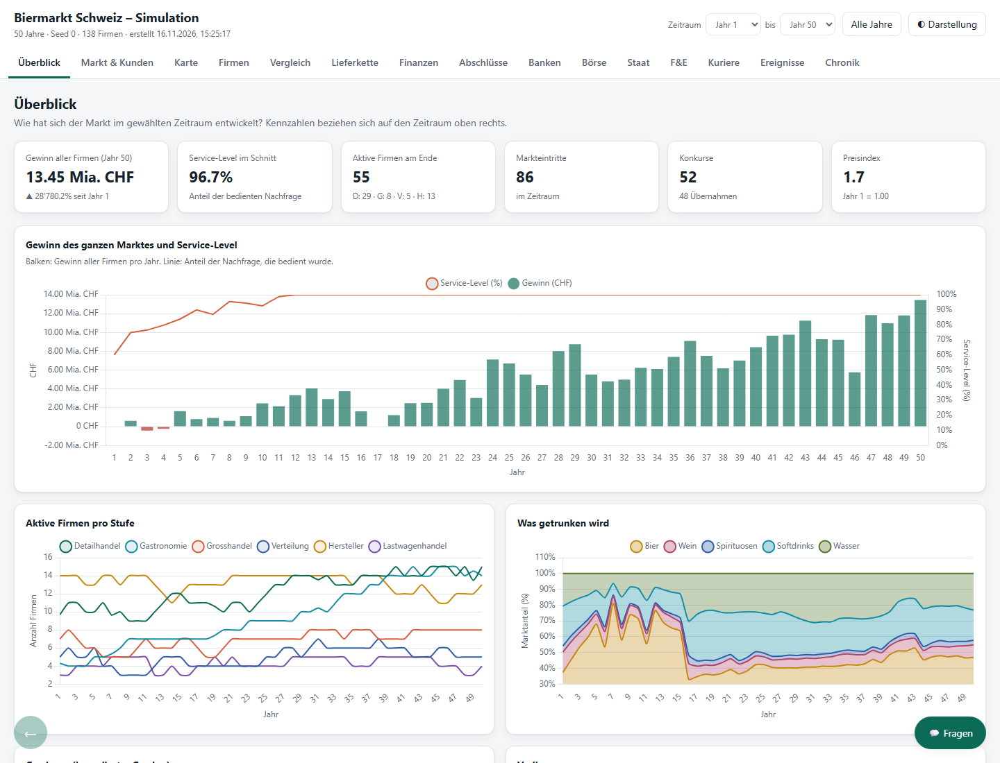

---

## Auf einen Blick

- **Umfang:** rund 38'000 Zeilen Python und 11'000 Zeilen JavaScript,
  über 600 automatische Tests, 175 Commits (Juli bis November 2026).
- **Simulation:** Lieferkette mit vier Stufen, 30 Kundenklassen, fünf
  Getränkearten, acht Regionen, 50 Jahre mit Tagesrhythmus.
- **Wirtschaft rundherum:** Banken und Nationalbank mit Leitzins, Börse mit
  Index und ETFs, Rohstoff- und Strommarkt, Staat mit Steuern, Gesetzen und
  Bussen, Forschung mit Patenten, Holdings und Fusionen.
- **Dashboard:** eine einzelne HTML-Datei mit 15 Reitern und über 100
  Diagrammen, ohne Server lauffähig.
- **Spielmodus:** Webanwendung mit Firmen-Cockpit, Speicherständen,
  Lieferverträgen, Holding und einem Berater auf Basis eines Sprachmodells.
- **Nachvollziehbar:** Jede Erweiterung lässt sich in einer
  Konfigurationsdatei abschalten. Ein Lauf ist mit gleichem Startwert
  (Seed) exakt wiederholbar.

## Was das Projekt zeigt

| Bereich | Umsetzung im Projekt |
|---|---|
| Supply Chain Management | Bestellpolitik (Base-Stock), Lieferantenwahl, Bullwhip-Effekt, Lieferverträge, Logistik mit eigener Flotte oder Kurier |
| Betriebswirtschaft | Erfolgsrechnung, Bilanz und Geldflussrechnung nach Schweizer Gliederung, Gewinnverwendung nach OR, Kalkulation pro Flasche |
| Volkswirtschaft | Teuerung, Leitzins nach Taylor-Regel, Konjunkturzyklen, Wechselkurs, Bevölkerungsentwicklung |
| Agentenbasierte Modellierung | Firmen mit fünf Strategietypen, die lernen, nachahmen und ihre Strategie wechseln |
| Software-Engineering | Modulare Python-Architektur, Pydantic-Konfiguration, Speicherstände, Paritätstests, über 600 Tests |
| Datenvisualisierung | Interaktives Dashboard mit Chart.js: Filter, Zeiträume, Vergleiche, Popups |
| KI-Einsatz | Sprachmodell schreibt Firmengeschichten und berät im Spiel, aber nur auf Basis berechneter Fakten |

---

## Dashboard

Das Dashboard entsteht nach jedem Lauf als eine einzige HTML-Datei. Oben
rechts wählt man den Zeitraum. Alle Diagramme, Kennzahlen und Tabellen
richten sich danach.

### Markt und Kunden
Marktanteile und Reputation der Marken, Teuerung und Bevölkerung,
Wechselkurs und Export, Kunden ohne passenden Preis.

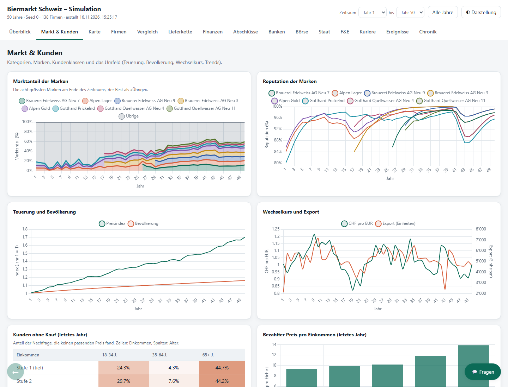

### Karte
Acht Regionen der Schweiz mit Bevölkerung, Firmen, Umsatz, Händlermarge,
Lohnniveau und Arbeitsmarkt.

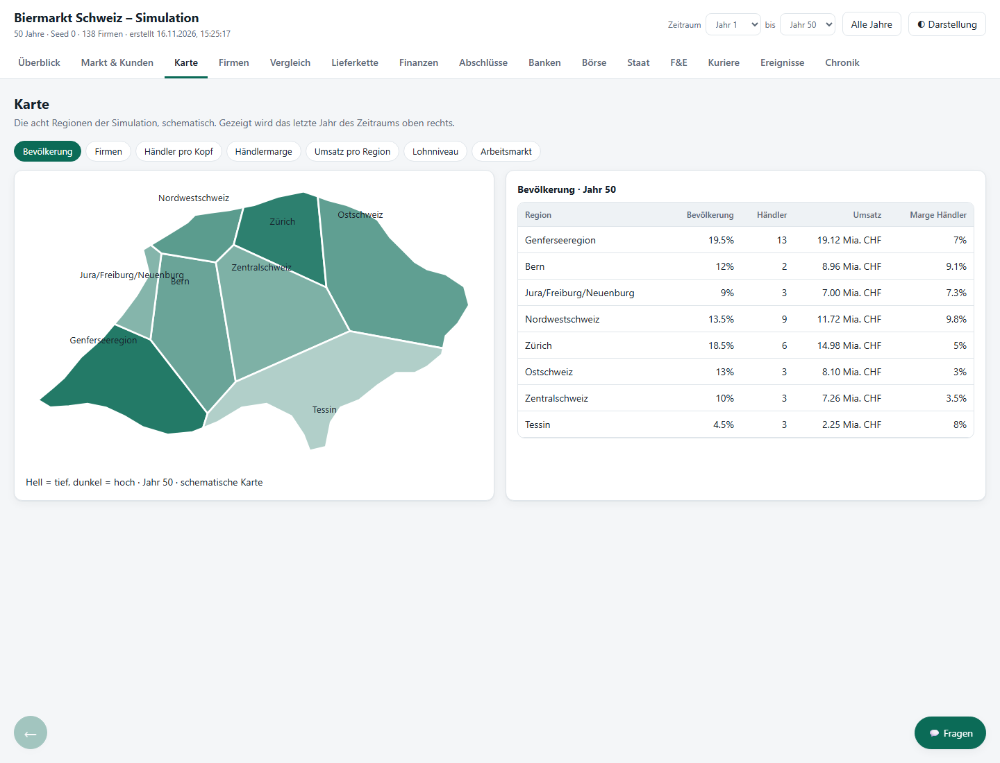

### Firmen
Alle Firmen mit Filtern nach Stufe, Kategorie, Region und Strategietyp. Ein
Klick öffnet die Detailansicht mit Umsatz, Kosten, Cash, Börsenkurs,
Forschung und allen Entscheidungen.

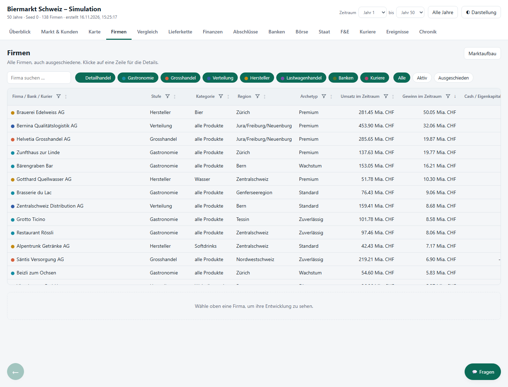

Detailansicht einer Firma, hier die Brauerei aus dem eigenen Spiel:

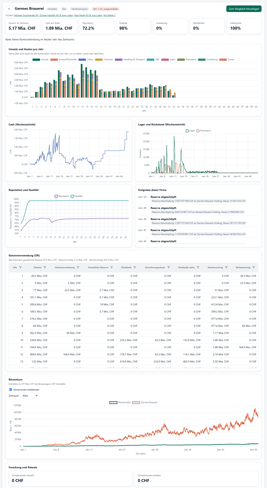

### Vergleich
Bis zu 40 Firmen in einem Diagramm, wahlweise relativ zum Schnitt ihrer
Stufe. Hier das Cash von drei Detailhändlern, die alle 50 Jahre im Markt
waren, mit Tabelle zu bestem und schlechtestem Jahr.

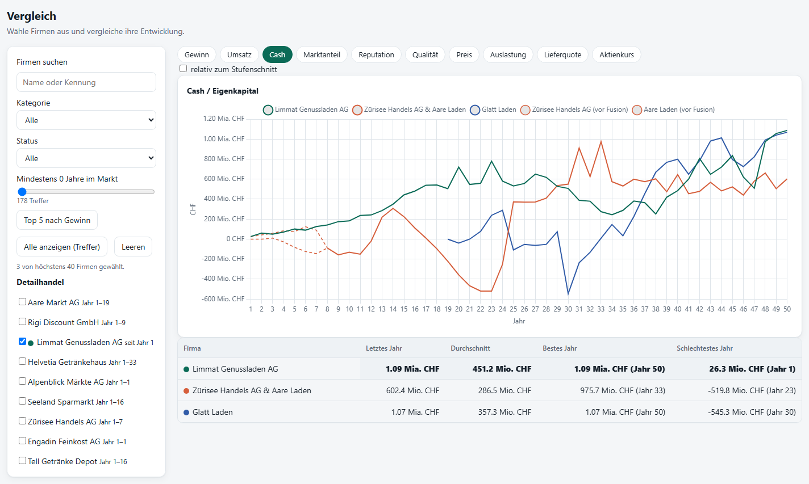

### Lieferkette
Marge und Auslastung pro Stufe, verlorene Verkäufe, Bullwhip-Faktor,
Transportkosten und Flotte.

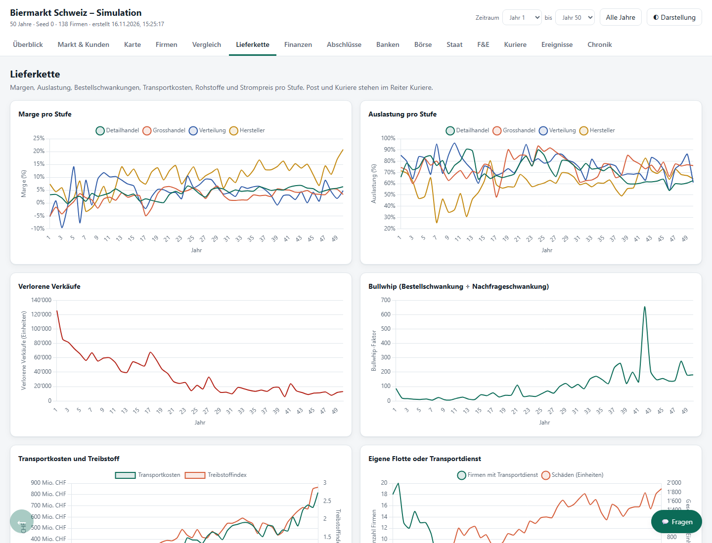

### Finanzen
Gewinnverwendung nach Obligationenrecht, Cash aller Firmen, Negativzinsen,
Schulden und Holdings mit ihren Töchtern. Ein Klick auf eine Holding
öffnet ein Fenster mit Diagrammen zur ganzen Gruppe.

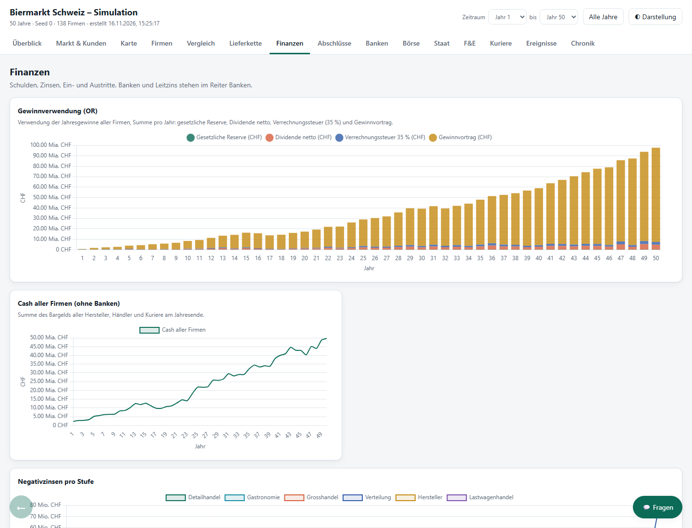

### Banken
Leitzins und Teuerung, Eigenkapital, Kredite und Einlagen der Banken,
Investitionskredite und Kreditausfälle.

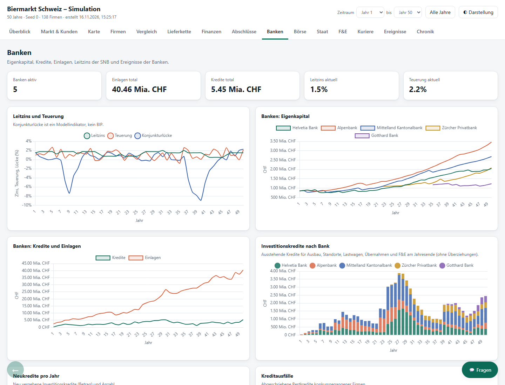

### Börse
Börsenindex mit Leitzins, Aktien, ETFs, Rohstoffe und Strompreis im
direkten Vergleich, mit wählbarem Zeitraum (YTD, 1 bis 10 Jahre oder von
Monat bis Monat).

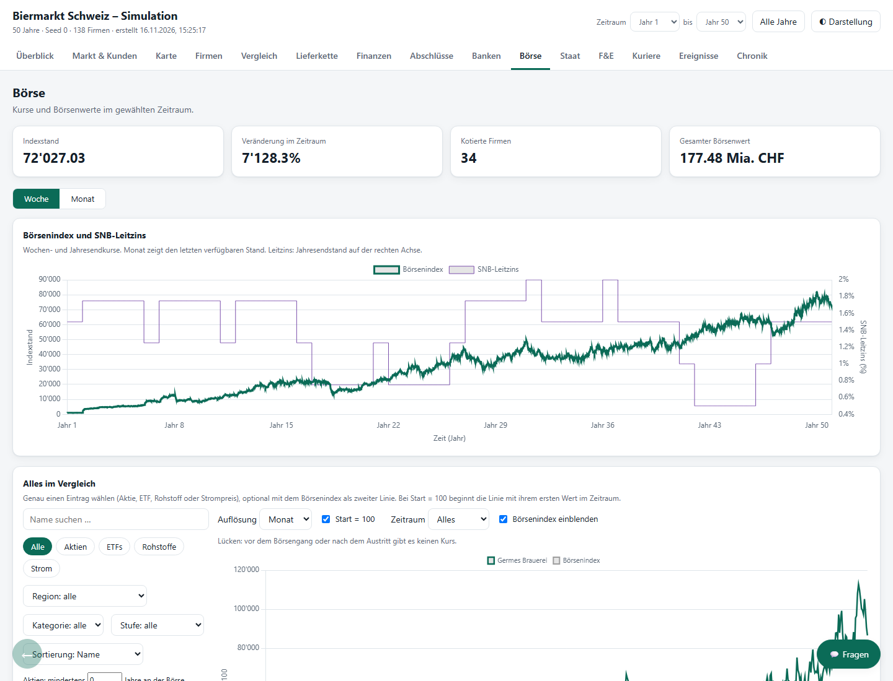

«Alles im Vergleich»: eine Aktie, ein ETF, ein Rohstoff oder der Strompreis,
wahlweise gegen den Börsenindex.

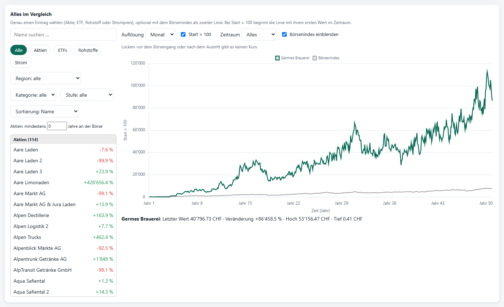

### Forschung und Entwicklung
Projekte pro Jahr, Ausgaben, Patente und ein Forschungsbaum pro Branche.

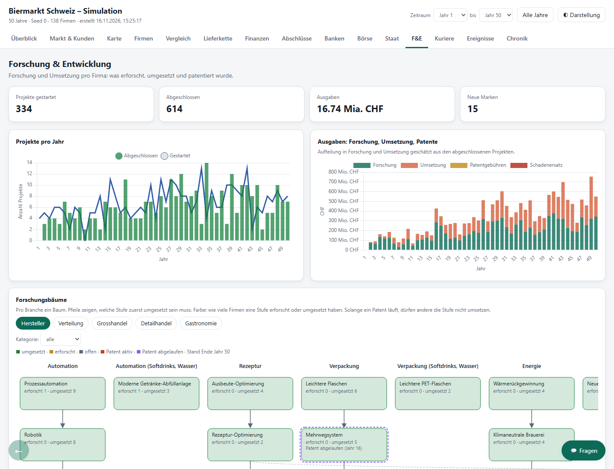

### Staat
Steuern, Straftaten und Bussen, Skandale und Wettbewerbsaufsicht. Für jede
Straftat rechnet die Simulation nach, ob sie sich für die Firma gelohnt hat.

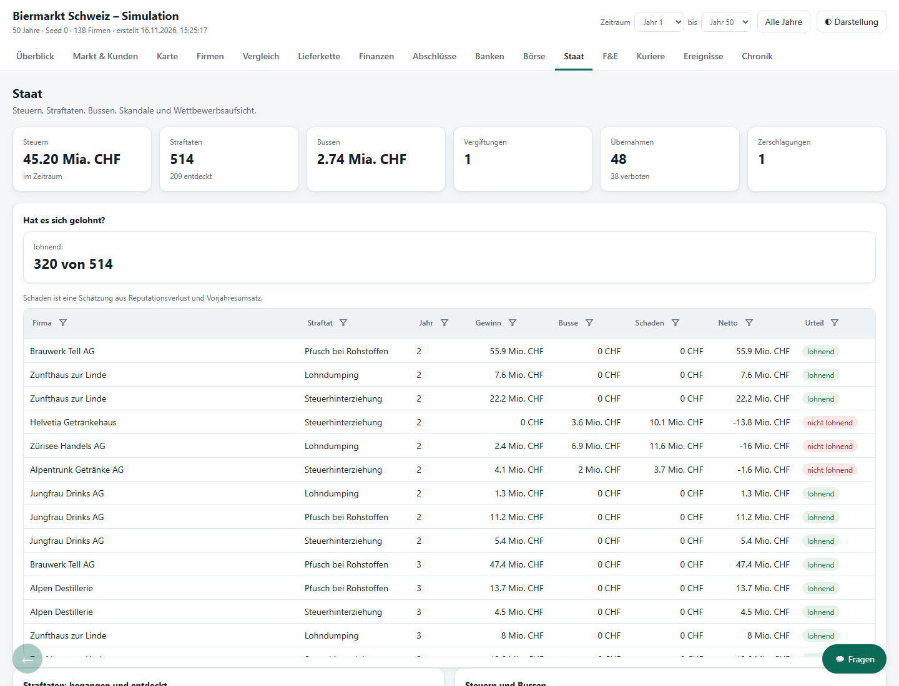

Weitere Reiter: Abschlüsse
(Erfolgsrechnung, Bilanz, Geldfluss je Firma und Jahr), Kuriere, Ereignisse
und eine Chronik. Ein Chat unten rechts beantwortet Fragen zum Lauf.

---

## Spielmodus: das Firmen-Cockpit

Man gründet eine eigene Firma als Hersteller, Verteiler, Grosshändler,
Detailhändler oder Gastronomiebetrieb und führt sie Runde für Runde
(eine Runde = ein Monat).

> **Screenshots folgen noch:** Übersicht des Cockpits, Produktion bzw.
> Verträge und Holding.

- **Reiter wie im Dashboard:** Übersicht, Firma, Markt, Forschung,
  Logistik, Produktion oder Einkauf, Verträge, Lager, Finanzen, Bank,
  Abschlüsse, Börse, Rohstoffe, Bevölkerung, Holding.
- **Entscheide:** Preise pro Marke, Einkauf, Produktionsziel, Personal,
  Marketing, Forschung, Kredite, Lastwagen, Standorte.
- **Lieferverträge:** Mindestmengen mit Preis und Laufzeit zwischen den
  Stufen. Gegenvorschläge und Verlängerungen bekommen sofort eine Antwort,
  Absagen nennen den Grund.
- **Holding:** Firmen kaufen, Töchter mit eigenem Chef führen, Geld zwischen
  Holding und Töchtern verschieben, Anträge der Töchter entscheiden.
- **Autopilot:** «Bis zum Ende simulieren» übergibt die Firma an den
  Autopiloten. Mit «Ruder übernehmen» führt man jederzeit wieder selbst.
- **Sicherheit:** Nach jeder Runde wird automatisch gespeichert. Ein
  Spielstand speichert nur die Eingaben und spielt sie beim Laden exakt
  nach.
- **Berater:** Ein Sprachmodell gibt Tipps, sieht aber nur die eigenen und
  die öffentlichen Zahlen.

---

## Wie die Simulation funktioniert

- **Lieferkette:** Detailhandel und Gastronomie → Grosshandel → Verteilung →
  Hersteller (Brauereien, Weingüter, Brennereien, Mineralwasser,
  Softdrinks, Importeure). Jede Firma bestellt bei mehreren Lieferanten und
  wählt nach Preis inklusive Transport, Zuverlässigkeit, Qualität und Ruf.
- **Nachfrage:** 30 Kundenklassen nach Einkommen, Alter und Trinkverhalten,
  jede mit Höchstpreis. Saison, Trends und eine alternde Bevölkerung
  verändern die Nachfrage.
- **Firmen als Agenten:** Fünf Strategietypen (günstig, Standard,
  zuverlässig, Premium, Wachstum) bestimmen Preis, Qualität, Löhne, Lager
  und Risiko. Firmen probieren aus, ahmen erfolgreiche Konkurrenten nach und
  wechseln die Strategie.
- **Geld:** Alle Beträge in Franken. Banken vergeben Kredite nach Bonität,
  die Nationalbank setzt den Leitzins, grosse Guthaben zahlen Negativzins.
  Gewinne werden nach Obligationenrecht verwendet (Reserve, Dividende,
  Verrechnungssteuer).
- **Markt im Wandel:** Neue Firmen treten ein, schwache gehen Konkurs oder
  werden übernommen, Holdings und Fusionen entstehen. Rezessionen,
  Missernten, Kostenschocks und Skandale treten zufällig auf.
- **Börse:** Tageskurse nach Ertragswert und Stimmung, ein verketteter
  Index und Branchen-ETFs.

Ein 50-Jahre-Lauf dauert einige Minuten. Mehrere Seeds lassen sich parallel
rechnen und statistisch auswerten.

---

## Technik

- **Sprache:** Python 3.12, Pydantic für die Konfiguration, PyYAML, pytest.
- **Frontend:** reines HTML, CSS und JavaScript mit Chart.js, ohne
  Build-Schritt.
- **Spielserver:** Python-Standardbibliothek (`http.server`), die
  Simulation läuft in einem eigenen Thread und hält zu jedem Monatsanfang an.
- **Sprachmodell:** GLM über die SwissAI-API (CSCS) oder lokal mit Ollama.
  Texte mit Zahlen, die nicht aus der Simulation stammen, werden verworfen.
- **Qualität:** über 600 Tests, darunter ein Paritätstest gegen die
  Beer-Game-Engine des Moduls und Tests für das wiederholbare Laden von
  Spielständen.

### Arbeitsweise

Das Projekt ist mit KI-Unterstützung entstanden. Planung, Architektur,
Spielregeln und Prüfung lagen bei mir. Den Code haben Programmier-Agenten
(Claude Code, Codex, GLM) nach meinen Vorgaben geschrieben. Jede
Ausbaustufe hat einen schriftlichen Bauplan mit Begründungen und Messwerten
im Ordner [`docs/`](docs/).

---

## Starten

```bash
python -m venv .venv
.venv/Scripts/python.exe -m pip install pydantic pyyaml pytest
```

Lauf über 50 Jahre mit Dashboard:

```bash
python -m market_sim.dashboard --seed 0 --out runs --open
```

Spielmodus, danach <http://localhost:8771> öffnen:

```bash
python -m market_sim.game.server --port 8771 --saves runs/spielstaende
```

Mehrere Seeds auswerten:

```bash
python -m market_sim.experiment --seeds 0-9 --skip-years 2 --out runs/experiment
```

Tests:

```bash
python -m pytest market_sim
```

Für Texte und Berater: den Schlüssel der SwissAI-API als Umgebungsvariable
`SWISSAI_RESEARCH_API_KEY` setzen. Ohne Schlüssel läuft alles andere normal.

---

## Aufbau des Repositorys

| Ordner | Inhalt |
|---|---|
| `market_sim/` | Simulation: Firmen, Kunden, Banken, Börse, Staat, Forschung, Holdings |
| `market_sim/config/` | Alle Stellschrauben (`market.yaml`), Firmen, Marken, Kunden, Personas |
| `market_sim/game/` | Spielmodus: Server, Spielablauf, Ansichten und Cockpit im Browser |
| `market_sim/tests/` | Automatische Tests |
| `docs/` | Baupläne, Entwürfe und Messprotokolle jeder Ausbaustufe |
| `team_bundle/` | Ursprüngliche Beer-Game-Agenten für die Engine des Moduls |

Mehr Details zu Regeln und Messwerten:
[`docs/bauplan-grosse-simulation.md`](docs/bauplan-grosse-simulation.md),
[`docs/bauplan-erweiterung-2.md`](docs/bauplan-erweiterung-2.md),
[`docs/bauplan-banken-boerse.md`](docs/bauplan-banken-boerse.md),
[`docs/entwurf-spielmodus.md`](docs/entwurf-spielmodus.md).

## Lizenz

MIT, siehe [LICENSE](LICENSE).
